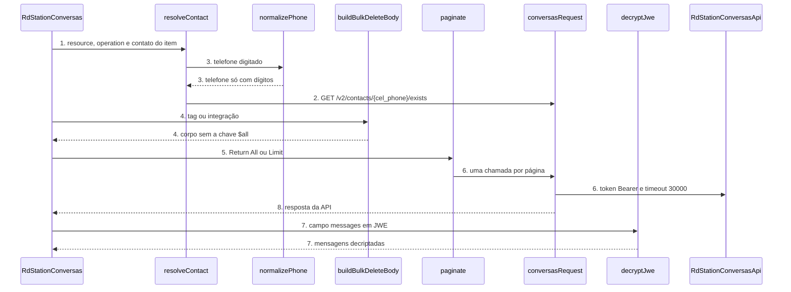

# RD Station Conversas: community node n8n versão 1.0.0

**Approved**: 2026-11-06 - user: "Aprovo os três (Recomendado · Jev 0,94)"

> Build this with **tlc-implement**. Every criterion becomes a check with a proof; nothing under
> the open questions is settled while building.

## Problem

Quem usa o RD Station Conversas (chat e WhatsApp, o antigo Tallos) e automatiza no n8n não tem node para ele. Hoje a pessoa monta cada chamada à mão no node HTTP Request: copia o token JWT do painel, escreve a base `api.tallos.com.br`, confere a rota e a versão (`/v1`, `/v2`, `/v3`, `/v4`), codifica o corpo de envio de mensagem como formulário e, para ler o histórico, precisa decriptar um JWE compacto (RSA-OAEP-256) que o n8n não decripta sozinho. Cada ID (contato, template, fluxo, atendente, campanha, campo personalizado) é digitado de cabeça, porque o painel não mostra o `_id` de 24 caracteres.

O custo é medido em passos manuais: o histórico de mensagens exige um script externo de decriptação, e as exclusões em massa (`DELETE /v2/contacts`) aceitam no corpo a chave `$all`, que apaga todos os contatos da empresa. A fonte não traz número de uso nem de incidente; a doc oficial só descreve as rotas.

Quando isso sair: o pacote `n8n-nodes-rd-station-conversas` instala pela lista de community nodes, a credencial testa o token com um clique, cada ID aparece como lista pesquisável com a opção de colar o ID ou o telefone, o histórico chega decriptado, e nenhuma operação do node consegue apagar todos os contatos de uma vez.

## Shape

Reutiliza só o que o n8n já oferece (`this.helpers.httpRequestWithAuthentication`, `NodeApiError`, `NodeOperationError`, Resource Locator) e o desenho do pacote Vizard (estilo programático, módulos por recurso, testes que chamam o `execute` com contexto falso); não duplica código de outro pacote, porque o repositório nasce vazio. As regras que mudam o resultado (normalizar telefone, resolver o contato, montar o corpo do apagar em massa, paginar, decriptar o histórico) ficam em funções puras e no `execute`, que os testes de contrato alcançam pelo `dist` sem rede.

1. entra o item do workflow -> `RdStationConversas` (new) - lê `resource` e `operation` e despacha para a operação
2. `resolveContact` (new) - no modo `By Phone`, chama `conversasRequest` em `GET /v2/contacts/{cel_phone}/exists` e devolve o `_id`; nos modos `From list` e `By ID` devolve o valor
3. `normalizePhone` (new) - tira `+`, espaços, hífen e parênteses do telefone e recusa o que não tiver de 8 a 15 dígitos
4. `buildBulkDeleteBody` (new) - monta o corpo de `DELETE /v2/contacts` só com `tag_name` ou só com `integration`; nenhum caminho do código emite a chave `$all`
5. `paginate` (new) - com Return All, repete a chamada de página em página até a rota dizer que acabou; com Limit, para ao atingir o limite
6. `conversasRequest` (new) - monta a requisição com a base `https://api.tallos.com.br`, `timeout` de 30000 ms e a credencial `rdStationConversasApi`; erro HTTP vira `NodeApiError` com os `errors[]` da API
7. `decryptJwe` (new) - no histórico, abre o JWE compacto com a chave JWK da credencial usando `node:crypto` e devolve o array de mensagens
8. out: `RdStationConversas` devolve os itens do n8n (um item por registro nas listas, `{ "deleted": true }` nas exclusões); `RdStationConversasApi` (new) autentica toda chamada e testa o token em `GET /v2/employees`

**Changes underneath**

| Front | What changes |
| --- | --- |
| domain | nada muda: o repositório e o pacote nascem nesta versão |
| stored data | nothing to migrate: o node não guarda dado, só repassa a requisição |
| readers | o editor do n8n lista o node e a credencial novos; nenhum workflow existente usa o pacote |

Data: none - o node não guarda dado; ele só repassa a requisição para a API do Conversas e devolve a resposta.

New: nothing - read only.

## Surface

| Route | In | Out | Status | Who |
| --- | --- | --- | --- | --- |
| node `rdStationConversas`, 42 operações em 13 recursos | `resource`, `operation` e os campos de cada operação | itens do n8n com a resposta da API; `{ "deleted": true }` nas exclusões | `200`; `401` da API com token inválido vira `NodeApiError`; `403` sem permissão no plano; demais `4xx` e `5xx` também | quem tem credencial com token JWT válido; sem ele a API devolve `401` |
| `listSearch` de contato, template, fluxo, atendente, campanha e campo personalizado | texto de busca e `paginationToken` | `{ results: [{ name, value }], paginationToken? }` | `200`; `401` da API com token inválido vira `NodeApiError` | o editor do n8n com credencial válida; sem ela a API devolve `401` |
| `loadOptions` de carteira, integração oficial, CRM workflow, etapa e departamento | `loadOptionsDependsOn` quando houver | lista `{ name, value }` | `200`; `401` da API com token inválido | o editor do n8n com credencial válida; sem ela a API devolve `401` |
| teste da credencial `rdStationConversasApi` | token JWT | mensagem de sucesso ou de falha no editor | `200`; `401` com token inválido, `403` sem permissão | quem preenche a credencial; token errado recebe `401` |
| `GET /v2/messages/history` decriptado pelo node | `customer_id` e filtros | um item por mensagem | `200`; `403` em plano sem o recurso; falha local antes da chamada se faltar a chave JWK | planos Pro e Advanced; os demais recebem `403` |

## Landing

| One-way door | Literal shape | Alternative rejected |
| --- | --- | --- |
| nome do pacote, do node e da credencial | pacote `n8n-nodes-rd-station-conversas`; node `name: 'rdStationConversas'`; credencial `name: 'rdStationConversasApi'`; versão do node `1` | nome genérico `conversas`: colidiria com outro pacote de chat e quebraria workflows salvos se mudasse depois |
| valores de `resource` e de `operation` | `contact`, `customField`, `employee`, `flow`, `crmWorkflow`, `job`, `message`, `report`, `template`, `wallet`, `whatsappIntegration`, `analytics`, `campaign`; operações em camelCase (`getByPhone`, `getAll`, `sendTemplate`, `deleteManyByTag`) | rótulos em português como valor: o `value` é gravado no workflow salvo e não pode mudar sem quebrá-lo |
| campos da credencial | `apiToken` (senha) e `privateKeyJwk` (senha, opcional) | um campo `baseUrl` editável: a doc só documenta uma base e outro servidor (`megasac`) tem uso NÃO CONFIRMADO |
| formato de saída | listas devolvem um item por registro; exclusão devolve `{ "deleted": true }`; histórico devolve um item por mensagem já decriptada | devolver `{ messages: "<JWE>" }` cru: obrigaria cada usuário a decriptar fora do n8n |
| decriptação sem dependência | `decryptJwe` com `node:crypto` (`createPrivateKey` de JWK, `privateDecrypt` com `oaepHash: 'sha256'`, AES-GCM e AES-CBC com HMAC) | `node-jose` ou `jose` em `dependencies`: a verificação do n8n proíbe dependência de runtime |
| a chave `$all` não existe no código | `buildBulkDeleteBody` só aceita `tag` ou `integration` e devolve `{ tag_name }` ou `{ integration }` | uma opção `Delete All Contacts` com confirmação: o dono excluiu (AD-008) |

- Nothing else in this change is hard to reverse

## Criteria

### S1: pacote, toolchain e CI do node-cli 0.55.5 (P1)

O repositório compila, passa no lint oficial, roda os testes e publica com os comandos do template.

**Acceptance Criteria**

1. WHEN `npm run build` roda THEN o sistema SHALL sair com código 0 e gerar `dist/nodes/RdStationConversas/RdStationConversas.node.js`, `dist/credentials/RdStationConversasApi.credentials.js` e o ícone SVG ao lado do node
2. WHEN `npm run lint` roda THEN `n8n-node lint` SHALL sair com código 0 e imprimir 0 erros
3. The `package.json` SHALL ter `"name": "n8n-nodes-rd-station-conversas"`, `"version": "1.0.0"`, `"build": "n8n-node build"`, `"lint": "n8n-node lint"`, `"n8n": { "strict": true }`, `@n8n/node-cli` `0.55.5` em `devDependencies`, o keyword `n8n-community-node-package` e nenhum campo `dependencies`
4. WHEN `npm test` roda THEN o sistema SHALL compilar e rodar `node --test test/*.test.cjs` com saída `# fail 0`
5. WHEN um Pull Request abre THEN o workflow de CI (arquivo ci.yml em .github/workflows) SHALL rodar `npm ci`, `npm run lint`, `npm test` e `npm run build`
6. WHEN uma tag `v1.0.0` chega ao GitHub THEN o workflow de publicação (arquivo publish.yml) SHALL validar que a tag é igual a `v` mais a versão do `package.json` e publicar no npm com provenance
7. IF a tag `v1.0.1` chega e o `package.json` diz `1.0.0` THEN o workflow SHALL falhar no passo de validação da tag e não publicar
8. WHEN qualquer operação do node envia uma requisição HTTP THEN as opções da requisição SHALL ter `timeout` igual a 30000
   - listar atendentes → `timeout: 30000`; histórico → `timeout: 30000`; apagar por tag → `timeout: 30000`

### S2: credencial com token JWT e chave opcional (P1)

A pessoa cola o token, clica em testar e sabe se funciona.

**Acceptance Criteria**

1. The credencial `rdStationConversasApi` SHALL ter `apiToken` com `typeOptions.password: true` e `privateKeyJwk` com `typeOptions.password: true` e `required: false`
2. WHEN o node envia uma requisição THEN o sistema SHALL mandar o header `Authorization: Bearer <apiToken>` e a base api.tallos.com.br com HTTPS, sem campo de base editável
3. WHEN o editor testa a credencial THEN o sistema SHALL chamar `GET /v2/employees` e mostrar sucesso com `200`
4. IF a API responde `401` ao teste THEN o sistema SHALL mostrar falha, e IF responde `403` THEN o sistema SHALL mostrar falha com o texto da API
5. The credencial SHALL ter `documentationUrl` apontando para a página de autenticação do Conversas e a dica do campo `apiToken` SHALL dizer onde gerar o token: Apps e Integrações, API
6. The dica do campo `privateKeyJwk` SHALL dizer que a chave só é usada no histórico de mensagens e que ela se gera em Apps e Integrações, API, Gerar Chave

### S3: contatos e campos personalizados (P1)

A pessoa cria, atualiza, busca e lista contatos, e gerencia campos personalizados, sem digitar ID.

**Acceptance Criteria**

1. WHEN o `execute` roda com `resource` `contact`, `operation` `getByPhone` e `phone` `+55 (11) 99999-8888` THEN o sistema SHALL chamar `GET /v2/contacts/5511999998888/exists` com o canal `whatsapp` por padrão
2. WHEN o `execute` roda com `operation` `getByCpf` e `cpf` `123.456.789-09` THEN o sistema SHALL chamar `GET /v2/contacts/cpf/12345678909/exists`
3. IF o telefone normalizado não tem de 8 a 15 dígitos THEN o sistema SHALL lançar `NodeOperationError` com a mensagem `The 'Phone' parameter is invalid [item 0]` e a descrição `Use the international format with country code, digits only, e.g. 5511999998888` sem enviar nenhuma requisição
   - `5511999998888` → aceito; `11999` → recusado; `+55 11 99999-8888` → aceito como `5511999998888`; vazio → recusado
4. WHEN o `execute` roda com `operation` `getAll`, `returnAll` verdadeiro e a API devolve páginas de 100, 100 e 37 contatos THEN o sistema SHALL chamar `GET /v2/customers` com `page` 1, 2 e 3 e devolver 237 itens
5. WHEN `returnAll` é falso e `limit` é 150 THEN o sistema SHALL parar após 150 itens e não pedir a página seguinte
6. WHEN o `execute` roda com `operation` `create` THEN o sistema SHALL chamar `POST /v2/contacts/whatsapp-business-by-brokers` com `cel_phone`, `full_name` e `integration` no corpo, e as tags, o CPF e demais campos de `Additional Fields` só quando preenchidos
7. IF `Workflow Stage` é informado sem `Workflow` THEN o sistema SHALL lançar `NodeOperationError` com a mensagem `The 'Workflow' parameter is empty [item 0]` e a descrição `Choose a workflow before choosing its stage`
8. WHEN o `execute` roda com `operation` `update` THEN o sistema SHALL chamar `PUT /v2/contacts/whatsapp-business-by-brokers` com `cel_phone`, `full_name` e `integration`
9. WHEN o `execute` roda com `operation` `updateByPhone` e `phone` `5511999998888` THEN o sistema SHALL chamar `PATCH /v2/contacts/5511999998888` e devolver `{ "customerId": "..." }` como item
10. WHEN o `execute` roda com `operation` `createMany` e 3 contatos THEN o sistema SHALL chamar `POST /v2/contacts/bulk` com `{ "contacts": [ ... 3 itens ... ] }` e devolver o `job` da resposta
11. WHEN o `execute` roda com `resource` `customField` e `operation` `create` THEN o sistema SHALL chamar `POST /v2/custom-fields` com `{ "label": ..., "info": ... }` e devolver o objeto `{ id, info, key, label }`
12. WHEN `operation` é `update` THEN o sistema SHALL chamar `PUT /v2/custom-fields/{id}` com `{ "info": ... }` e a tela SHALL não oferecer o campo `label`
13. WHEN `operation` é `delete` e a API responde `204` THEN o sistema SHALL devolver o item `{ "deleted": true }`
14. WHEN `operation` é `getAll` THEN o sistema SHALL chamar `GET /v2/custom-fields` com `page`, `limit` e `label`, e parar quando `page * limit` alcançar o `total` da resposta

### S4: mensagens, template e histórico decriptado (P1)

A pessoa envia texto, anexo e template, e lê o histórico já decriptado.

**Acceptance Criteria**

1. WHEN o `execute` roda com `resource` `message`, `operation` `send`, contato com modo `By Phone` `5511999998888`, `message` `Olá` e `sentBy` `bot` THEN o sistema SHALL chamar `GET /v2/contacts/5511999998888/exists` e depois `POST /v2/messages/{_id}/send` com `message=Ol%C3%A1` e `sent_by=bot` no corpo urlencoded
2. IF `sentBy` é `operator` e nenhum atendente foi escolhido THEN o sistema SHALL lançar `NodeOperationError` com a mensagem `The 'Employee' parameter is empty [item 0]` e a descrição `Choose the employee who sends the message, or use Sent By: Bot`
3. WHEN há um binário na propriedade `attach` THEN o sistema SHALL enviar o corpo como multipart com o campo `attach` e os demais campos de texto
4. WHEN o `execute` roda com `operation` `sendTemplate`, `phone` `5511999998888`, template `abc123` e `variables` `["Ana","12/11"]` THEN o sistema SHALL chamar `POST /v3/messages/template/send` com `recipient_number`, `template_message_id` e `variables`, `country_code` `55` e `sent_by` `bot`
5. IF `sent_by` é `operator` e `operator_id` está vazio na operação `sendTemplate` THEN o sistema SHALL lançar `NodeOperationError` com a descrição `Choose an employee, or use Sent By: Bot`
6. WHEN a API responde `201` ao `sendTemplate` THEN o sistema SHALL devolver `{ data, message }` da resposta e a descrição da operação SHALL avisar que `201` não garante entrega
7. IF a API responde `404` com `code` 301 THEN o sistema SHALL lançar `NodeApiError` cuja mensagem cita o telefone e cuja descrição diz que não há contato com esse número
8. WHEN o `execute` roda com `operation` `getHistory` e a credencial tem `privateKeyJwk` THEN o sistema SHALL chamar `GET /v2/messages/history` com `customer_id`, `limit` 100 e `page`, abrir o campo `messages` com `decryptJwe` e devolver um item por mensagem
9. WHEN o teste cifra `[{"content":"oi","sent_by":"customer"}]` com uma chave RSA gerada no próprio teste, com `alg` RSA-OAEP-256 e `enc` A256GCM THEN o node SHALL devolver o item `{ "content": "oi", "sent_by": "customer" }`
10. WHEN o teste repete a cifra com `enc` A128CBC-HS256 THEN o node SHALL devolver os mesmos itens
    - A128GCM, A192GCM, A256GCM e A128CBC-HS256, A192CBC-HS384, A256CBC-HS512 → todos decriptados; `enc` desconhecido → falha do item 12
11. IF a credencial não tem `privateKeyJwk` THEN o sistema SHALL lançar `NodeOperationError` com a mensagem `The credential 'Private Key (JWK)' is empty [item 0]` e a descrição `Generate the key in RD Station Conversas: Apps and Integrations, API, Generate Key, then paste the JWK JSON in the credential`, sem enviar nenhuma requisição
12. IF o JWE não abre com a chave (chave de outra conta, `enc` desconhecido, JWE adulterado) THEN o sistema SHALL lançar `NodeOperationError` com a mensagem `The messages could not be decrypted [item 0]` e a descrição que cita o `enc` lido do cabeçalho e diz que a chave deve ser da mesma conta
13. WHEN `startDate` e `endDate` são informados THEN o sistema SHALL enviá-los em `start_date` e `end_date` no formato `YYYY-MM-DD`, e os filtros `channel`, `sent_by` e `type` SHALL ir como arrays com os padrões `["whatsapp"]`, `["customer","operator"]` e `["text"]`
14. IF a API responde `403` ao histórico THEN o sistema SHALL lançar `NodeApiError` com a descrição `Message history needs the Pro or Advanced plan`

### S5: operações em massa e irreversíveis (P1)

As operações que mexem em muitos contatos são explícitas e nenhuma apaga a base inteira.

**Acceptance Criteria**

1. WHEN o `execute` roda com `operation` `deleteManyByTag` e `tag` `lead-frio` THEN o sistema SHALL chamar `DELETE /v2/contacts` com o corpo exatamente `{ "tag_name": "lead-frio" }` e devolver `{ "contacts_count": ... }` da resposta
2. WHEN o `execute` roda com `operation` `deleteManyByIntegration` e `integration` `integration-1` THEN o sistema SHALL chamar `DELETE /v2/contacts` com o corpo exatamente `{ "integration": "integration-1" }`
3. IF a tag está vazia ou só tem espaços THEN o sistema SHALL lançar `NodeOperationError` com a mensagem `The 'Tag' parameter is empty [item 0]` e a descrição `Enter the tag whose contacts you want to delete`, sem enviar nenhuma requisição
   - `""` → recusado; `"   "` → recusado; `"$all"` → enviado como `{ "tag_name": "$all" }` e nunca como a chave `$all`
4. The node SHALL nunca enviar a chave `$all` em nenhum corpo de nenhuma operação: o teste percorre todas as operações com entradas vazias, nulas e `"$all"` e SHALL verificar que nenhuma requisição gravada tem `$all` entre as chaves do corpo
5. The lista de operações de `contact` SHALL não ter nenhuma operação de apagar todos os contatos nem campo `Delete All`
6. The descrição de `deleteManyByTag` e de `deleteManyByIntegration` SHALL começar com `Warning: permanently deletes`, dizer que a exclusão não tem volta e que vale para todos os contatos com a tag ou a integração
7. WHEN o `execute` roda com `resource` `flow` e `operation` `resetAllContactsFlow` THEN o sistema SHALL chamar `POST /v2/reset-customers-flow-processes` sem corpo e devolver `{ "message": ... }`
8. IF `resetAllContactsFlow` roda com `confirmRestart` falso (o padrão) THEN o sistema SHALL lançar `NodeOperationError` com a mensagem `Turn on 'Confirm Restart' to restart the flow of the contacts [item 0]` sem enviar nenhuma requisição; WHEN `confirmRestart` é verdadeiro THEN o sistema SHALL seguir o critério 7
9. The descrição de `resetAllContactsFlow` SHALL começar com `Warning: restarts the flow of the contacts` e dizer que o escopo exato não está documentado e que a operação pode valer para todos os contatos
10. WHEN o `execute` roda com `resource` `wallet` e `operation` `removeAllContacts` e `wallet` `VIP` THEN o sistema SHALL chamar `POST /v2/customers/wallets/remove-all` com `{ "wallet_name": "VIP" }` e devolver `{ "quantityModified": ... }`
11. WHEN o `execute` roda com `resource` `employee` e `operation` `deactivateMany` e 2 IDs THEN o sistema SHALL chamar `PATCH /v2/employees/deactivate` com `{ "employees_ids": ["a","b"] }`
12. WHEN a API responde `207` a `deactivateMany` THEN o sistema SHALL devolver um item por funcionário com `employee_id`, `success`, `status_code` e `status_message`
13. WHEN `operation` é `createMany` em `employee` com 2 funcionários THEN o sistema SHALL chamar `POST /v2/employees/bulk` com `email`, `name` e `role` de cada um e devolver o `job`

### S6: atendentes, fluxos, workflows, jobs, templates, carteiras e integrações (P2)

A pessoa gerencia o restante da conta escolhendo em listas.

**Acceptance Criteria**

1. WHEN `resource` é `employee` e `operation` é `getAll` THEN o sistema SHALL chamar `GET /v2/employees` e devolver um item por atendente com `id`, `name` e `email`
2. WHEN `operation` é `get` com o atendente `emp1` THEN o sistema SHALL chamar `GET /v1/employees/emp1` e devolver `email`, `role` e `departments`
3. WHEN `operation` é `activate` ou `deactivate` com o atendente `emp1` THEN o sistema SHALL chamar `PUT /v2/employees/emp1/activate` ou `PUT /v2/employees/emp1/deactivate` e devolver `{ "message": ... }`
4. WHEN `resource` é `flow` e `operation` é `getAll` THEN o sistema SHALL chamar `GET /v2/flows` e devolver um item por fluxo com `id` e `title`
5. WHEN `operation` é `forwardContact` com contato `c1` e fluxo `f1` THEN o sistema SHALL chamar `POST /v2/forward-to-customer` com `{ "customer": "c1", "flow": "f1" }`
6. WHEN `resource` é `crmWorkflow` e `operation` é `getAll` THEN o sistema SHALL chamar `GET /v2/workflows` e devolver um item por workflow com `title` e `stages`
7. WHEN `resource` é `job` e `operation` é `get` com `jobId` `j1` THEN o sistema SHALL chamar `GET /v2/jobs/j1` e devolver `status`, `totalItems`, `successfulItems`, `failedItems` e `result`
8. WHEN `resource` é `template` e `operation` é `getAll` THEN o sistema SHALL chamar `GET /v2/template/all` e devolver um item por template
9. WHEN `resource` é `wallet` e `operation` é `getAll` THEN o sistema SHALL chamar `GET /v2/wallets` e devolver um item `{ "name": ... }` por carteira
10. WHEN `operation` é `addContact` com contato `c1` e carteira `VIP` THEN o sistema SHALL chamar `POST /v2/wallets` com `{ "customer": "c1", "wallet": "VIP" }`
11. WHEN `operation` é `removeContact` com contato `c1` e a API responde `204` THEN o sistema SHALL chamar `PATCH /v2/wallets/c1` e devolver `{ "deleted": true }`
12. WHEN `resource` é `whatsappIntegration` e `operation` é `getAll` THEN o sistema SHALL chamar `GET /v2/whatsapp/integrations`, e com `Official Only` verdadeiro SHALL chamar `GET /v2/whatsapp/integrations/official` e devolver `key` e `label`

### S7: relatórios, analytics e campanhas (P2)

A pessoa lê métricas e campanhas sem montar a query à mão.

**Acceptance Criteria**

1. WHEN `resource` é `report` e `operation` é `getAll` com `startDate` `2026-10-01` e `endDate` `2026-10-31` THEN o sistema SHALL chamar `GET /v4/reports` com `start_date` e `end_date` e o `type` `operators` por padrão
2. WHEN `operation` é `getCampaignReport` com a campanha `cp1`, `returnAll` verdadeiro e a API devolve `pages` 3 THEN o sistema SHALL chamar `GET /v4/reports/campaign/cp1` com `limit` 50 e `page` 1, 2 e 3 e devolver um item por registro de `docs`
3. WHEN `resource` é `analytics` e `operation` é `getAttendanceSummary` com `timezone` `America/Sao_Paulo` THEN o sistema SHALL chamar `GET /v1/analytics/attendances/summary` com `start_date`, `end_date` e `timezone` em ISO 8601
4. WHEN `operation` é `getRetention`, `getReviewsAverage` ou `getContactsOrigin` THEN o sistema SHALL chamar `GET /v1/analytics/attendances/retention`, `GET /v1/analytics/attendances/reviews/average` ou `GET /v1/analytics/contacts/origin` e devolver um item com a resposta
5. WHEN `department_ids` ou `employee_ids` têm valores THEN o sistema SHALL enviá-los separados por vírgula
6. WHEN `resource` é `campaign` e `operation` é `getAll` com `returnAll` verdadeiro e a API responde `has_more` verdadeiro, verdadeiro, falso THEN o sistema SHALL chamar `GET /v1/campaigns` com `page` 1, 2 e 3 e `limit` 100
7. WHEN `operation` é `get` com a campanha `cp1` THEN o sistema SHALL chamar `GET /v1/campaigns/cp1` e devolver `segmentation`, `template`, `stats` e `clicks_stats`

### S8: campos guiados e erros no padrão do n8n (P1)

Cada campo de ID mostra uma lista; cada erro diz o que houve e como sair.

**Acceptance Criteria**

1. The node SHALL expor como `resourceLocator` com modos `list` (padrão, `searchable: true`) e `id` os parâmetros de contato (com o modo extra `phone` nas rotas que pedem `_id`), template, fluxo, atendente, campanha e campo personalizado
2. WHEN o editor pede a lista de contatos com a busca `ana` THEN o `listSearch` SHALL chamar `GET /v2/customers` com `page` e `limit` 100 e devolver os contatos cujo `full_name` contém `ana` sem diferenciar acento nem caixa, com `paginationToken` para a página seguinte
3. WHEN o editor pede a lista de templates com a busca `boas` THEN o `listSearch` SHALL chamar `GET /v2/template/all` e devolver só os `title` que contêm `boas`
4. WHEN o editor abre o campo `Integration` THEN o `loadOptions` SHALL chamar `GET /v2/whatsapp/integrations/official` e listar `label` com valor `key`
5. WHEN o editor abre o campo `Workflow Stage` com o workflow `Vendas` escolhido THEN o `loadOptions` SHALL listar só as `stages` desse workflow
6. WHEN o editor abre o campo `Departments` THEN o `loadOptions` SHALL montar a lista com os `departments` de `GET /v1/employees/{id}` dos primeiros 50 atendentes, sem repetir `key`
7. WHEN o modo `By Phone` resolve o telefone e a API responde `404` THEN o sistema SHALL lançar `NodeOperationError` com a mensagem `No contact found for the phone in the 'Contact' parameter [item 0]` e a descrição `Check the number or create the contact first`
8. WHEN a API responde `422` com `{ "message": "...", "errors": [{ "field": "name", "message": "..." }] }` THEN o `NodeApiError` SHALL ter como mensagem a `message` da API e como descrição cada `field: message`
9. WHEN `continueOnFail` está ligado e a API responde `4xx` no item 1 de 3 THEN o sistema SHALL devolver o item com `{ "error": ... }` e processar o item 2
10. The labels de parâmetro e de operação SHALL ser Title Case em inglês, as descrições de parâmetro SHALL ser frase com inicial maiúscula, as descrições booleanas SHALL começar com `Whether`, e os placeholders SHALL começar com `e.g.`
11. The campos de telefone SHALL ter a dica `International format, digits only, e.g. 5511999998888` e a operação `getAll` com paginação SHALL ter `Return All` e `Limit` com mínimo 1
12. The node SHALL ter `usableAsTool: true`, `inputs` e `outputs` de uma conexão `main` e `subtitle` com operação e recurso

### S9: documentação em PT-BR e lançamento 1.0.0 (P2)

A pessoa instala, configura e usa a partir do README; a versão chega ao npm com provenance.

**Acceptance Criteria**

1. The README SHALL estar em português do Brasil, com as seções Instalação, Credencial, Recursos e operações, Chave de criptografia do histórico, Operações irreversíveis, Planos (Pro e Advanced), Limites e Licença, no formato do README do pacote CRM
2. The README SHALL listar as 42 operações cobertas e as rotas deprecadas deixadas de fora
3. The `CHANGELOG.md` SHALL ter a seção `## 1.0.0` listando o node, a credencial, o histórico decriptado e a ausência de gatilho
4. The código SHALL ter comentário em português do Brasil em cada função e em cada bloco não óbvio, dizendo o que faz e por quê
5. WHEN a tag `v1.0.0` chega ao GitHub THEN `npm view n8n-nodes-rd-station-conversas version` SHALL devolver `1.0.0`

## Out of scope

| Excluded | Why |
| --- | --- |
| Node gatilho (trigger) | A doc do Conversas não descreve webhook, evento nem payload (AD-006) |
| Rotas deprecadas: criar contato genérico, criar e atualizar contato WhatsApp Business, os dois envios de template preenchido e a rota `/api/v3` de template | A doc as marca como deprecadas (AD-007) |
| Apagar todos os contatos (`$all`) | Operação de risco máximo; o dono excluiu (AD-008) |
| Esperar o fim de um job de criação em massa | A API só devolve o `job`; a pessoa usa `Job: Get` num laço com Wait do n8n |
| Listar departamentos e tags por endpoint próprio | A doc não tem rota; departamentos vêm dos atendentes e tags vêm só do contato |
| Servidores alternativos (`api.megasac.tallos.com.br` e `kong.tallos.com.br/megasac-api`) | Uso e diferença NÃO CONFIRMADOS; a base é fixa |
| Parâmetro `Simplify` na saída | O pedido é cobrir as rotas; a saída bruta já é a da API |
| Reintentar ao receber `429` | A doc não documenta limite de taxa nem `429`; o erro vira `NodeApiError` |
| Outros produtos RD (CRM e Marketing) | Pacotes e repositórios próprios (AD-001) |

## Assumptions

| Assumption | Chosen default | Rationale | Confirmed? |
| --- | --- | --- | --- |
| Corpo de `POST /v2/messages/{contact_id}/send` | `application/x-www-form-urlencoded` sem anexo e multipart com anexo | A doc diz urlencoded, mas `attach` é binário, o que só cabe em multipart | n |
| Formato de `customizable_field` na escrita (`PATCH /v2/contacts/{cel_phone}`) | Array `[{ "label": "...", "info": "..." }]`, igual ao que a API devolve na leitura | A doc de escrita não mostra os itens | n |
| Valor de `enc` do JWE do histórico | O node aceita A128GCM, A192GCM, A256GCM, A128CBC-HS256, A192CBC-HS384 e A256CBC-HS512; outro valor falha com mensagem que cita o `enc` | A doc usa `node-jose`, cujo padrão de cifra é A128CBC-HS256; o `enc` real não está documentado | n |
| `node:crypto` passa no `n8n-node lint` | Importa `node:crypto` em `decryptJwe` sem dependência | Módulo nativo do Node, não pacote; se o lint recusar, a decisão volta ao dono | n |
| Limite de itens por página de `GET /v2/customers` | `limit` 100 | A doc exige `limit` maior que 1 e não traz teto; 100 é o teto das outras listas | n |
| Telefone aceita `+`, espaços, hífen e parênteses e vira só dígitos | Normaliza e recusa fora de 8 a 15 dígitos (E.164) | A doc pede só dígitos; normalizar evita erro de digitação | n |
| `timeout` de toda requisição | 30000 ms | A doc não informa tempo de resposta; 30 s cobre listas grandes | n |
| Valores de `role` ao criar atendente | Opções `admin`, `operator` e `manager` | A doc cita esse enum em `/v1/employees/{id}`; para criar em massa o enum NÃO CONFIRMADO | n |
| Lista de departamentos | Montada a partir de `GET /v1/employees/{id}` dos primeiros 50 atendentes; o valor é o `key` | Não há rota de listagem; o custo é uma chamada por atendente | n |
| Uso de `department_ids` nos relatórios | Recebe o `key` do departamento | A doc não diz se o valor é `key` ou `id` | n |
| Escopo de `POST /v2/reset-customers-flow-processes` | A descrição avisa que pode valer para todos os contatos | A doc não traz corpo nem escopo; o aviso é o limite que o dono pediu | n |
| Ícone do node | Ícone SVG próprio e genérico de chat | O pedido não trouxe arte oficial da marca | n |
| Rótulos e mensagens do node | Em inglês | A UX guideline do n8n escreve em inglês; só o README e os comentários são PT-BR | n |
| Planos | O node não checa o plano; o `403` da API vira mensagem que cita Pro e Advanced onde a doc cita | Checar o plano exigiria rota que a doc não tem | n |

**Open questions:** none - all resolved or logged above.

## Differences from the source

None - the product matches the source

## Sources

- Pedido do dono, 06/11/2026: novo community node n8n "RD Station Conversas" (chat e WhatsApp, antigo Tallos), repositório local `Rd Station Conversas Node` - binding - escopo, decisões e AD-001 a AD-011
- Catálogo da API do Conversas coletado em 06/11/2026 das páginas `conversas-v2-*` de developers.rdstation.com (47 rotas, 5 deprecadas) - binding - rotas, corpos, status e lacunas
- Template e guias `.agents/` do `@n8n/node-cli` 0.55.5 (`nodes.md`, `nodes-programmatic.md`, `properties.md`, `credentials.md`) - binding - estilo programático, Resource Locator, credencial
- n8n UX guidelines (docs.n8n.io, `ux-guidelines`) - binding - Title Case, `{ "deleted": true }`, formato dos erros, `Return All` e `Limit`
- Pacote Vizard (`test/vizard.test.cjs` e `.github/workflows`) - binding - padrão de teste com contexto falso, CI e publicação por tag com provenance
